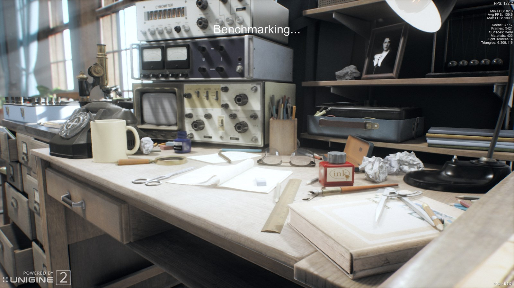
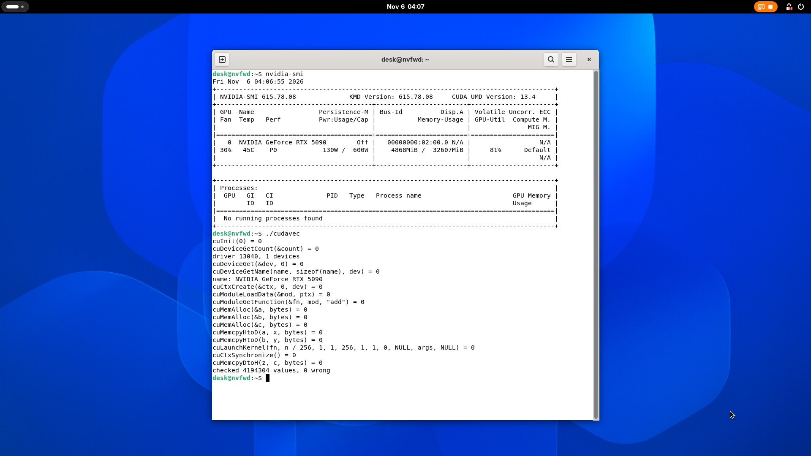
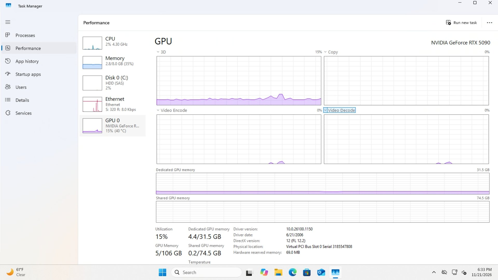
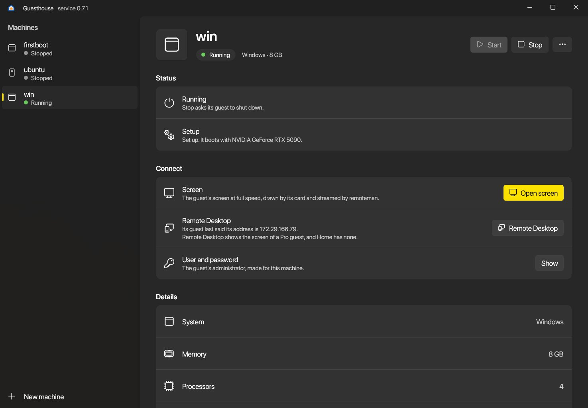

<div align="center">


# Guesthouse

### A real GPU in your virtual machines.

Windows and Linux virtual machines that share the graphics card your desktop is already using,<br>
with the card maker's own driver inside. Nothing is passed through, and your desktop keeps its card.

[](https://guesthouse.ruxn.com)
[](https://discord.gg/rN3VARayZV)
[](https://github.com/ruxnhq/guesthouse/releases/latest)
[](https://guesthouse.ruxn.com/#download)
[](https://github.com/ruxnhq/guesthouse/actions/workflows/checks.yml)
[](LICENSE)

**[Website](https://guesthouse.ruxn.com)** · **[Download](https://guesthouse.ruxn.com/#download)** · **[Cards](https://guesthouse.ruxn.com/#cards)** · **[How it works](ARCHITECTURE.md)** · **[Discord](https://discord.gg/rN3VARayZV)**

<br>


<sub>Godot on Vulkan, in Windows, in a VM on Linux. The desktop around it runs on the same card.</sub>

</div>

<br>

Guesthouse teaches KVM, and Windows 11's Virtual Machine Platform, to speak Hyper-V's GPU protocol, GPU-PV. The guest finds what looks like a Hyper-V GPU and loads the card maker's unmodified driver, and the commands it writes run straight on the card.

| | |
|:---:|:---:|
|  |  |
| **Windows guests** · Direct3D 12 and 11, Vulkan, OpenGL, CUDA, NVENC | **Linux guests** · CUDA, Vulkan and video at about host speed |
|  |  |
| **Windows hosts** · Windows 11 Home or Pro, no Hyper-V needed | **The app** · give it an ISO, and it installs the guest with its GPU |

> [!NOTE]
> **Early days.** Linux 0.8.0 is out, and Windows hosts are a preview. NVIDIA works best, AMD is newer, Intel Arc is an experiment, and macOS guests are a [preview](docs/macos.md). [The site](https://guesthouse.ruxn.com/#cards) lists every card it has run on.

## Install

**Linux** · x86_64 with KVM

```sh
curl -fsSL https://raw.githubusercontent.com/ruxnhq/guesthouse/main/install.sh | sh
```

The script is meant to be read first, and [what it does](docs/install.md) is written out step by step. Or download the AppImage from the [latest release](https://github.com/ruxnhq/guesthouse/releases/latest) and open it: it shows the same plan in a window, and does the same install. On NixOS there's a [flake](docs/nixos.md).

**Windows 11** · Home or Pro, x64

Get the installer from **[guesthouse.ruxn.com](https://guesthouse.ruxn.com/#download)**. [How it works on Windows](docs/windows-host.md).

## What a machine can do

On Linux hosts, from 0.8.0.

- **Duplicate, throwaway, export.** Copy a machine in a second, run one that forgets everything when it stops, or move one to another PC as a single file. [Copies](docs/copies.md).
- **Ready-made machines.** Pick a recipe at install and the machine comes set up, with Steam on Windows or the CUDA toolkit on Ubuntu. Or write your own. [Recipes](docs/recipes.md).
- **Lean Windows.** Install Windows without the apps most people never open in a VM. Off unless you choose it. [What it takes out](docs/recipes.md#lean-windows).
- **Snapshots before a risky start.** A machine can save a snapshot by itself before a change that may leave Windows unable to come up, such as a new display driver. Off by default.
- **See how the card is shared.** The library shows each running machine's part of the card.
- **No window needed.** Everything above is in `guesthouse-vm` too. [The commands](docs/headless.md).

## Is it safe?

Programs in a VM can't read each other's memory, and the guest only ever talks to Guesthouse's daemon, which checks what it's sent and runs jailed. A guest can still slow the card down for everyone, and a bug in the GPU driver is a bug in your kernel, so only run guests you trust. [The full picture](docs/security.md).

## Reporting a bug

In the app, choose **Show Log** in the menu and press **Send Report**. If the app won't open, `guesthouse-report` does the same from a terminal. Nothing is sent until you say so. [What a report holds, and where it goes](docs/reporting.md).

Questions and chat are on [Discord](https://discord.gg/rN3VARayZV). Bugs go in the [issues](https://github.com/ruxnhq/guesthouse/issues), so they don't get lost.

## Working on it

The same code builds on Linux and on Windows, and each builds the host for the system it's on. A Linux build is the daemon and the GTK app, and a Windows build is the service and the Windows app. The other system's crates build empty, so `cargo test` works on both, but the GTK app only builds on Linux. Neither needs a GPU.

On Linux, with Rust 1.88 or newer:

```sh
cargo test                     # everything but the app
cargo run -p guesthouse-app    # needs GTK 4.16 and libadwaita 1.5 development files
```

On Windows 11, with Rust 1.95 or newer and Visual Studio's C++ build tools:

```powershell
cargo test                               # everything but the app
cargo build --release -p guesthouse-service -p guesthouse-host-windows
.\target\release\guesthouse-service.exe run   # in an elevated prompt, until Ctrl+C
cargo run -p guesthouse-app-windows      # the window, which asks the service for everything
```

The service is in `crates/service-windows`, and the serial relay it needs beside it comes from `crates/host-windows`. On Linux a VM also needs QEMU with the patch in `qemu/`, which cargo doesn't build.

[CONTRIBUTING.md](CONTRIBUTING.md) has the rest, and [ARCHITECTURE.md](ARCHITECTURE.md) explains how it fits together.

## Bring your own

There are no NVIDIA, AMD, Intel or Microsoft binaries in this repo. You bring your own Windows ISO and GPU driver, and [THIRD-PARTY.md](THIRD-PARTY.md) lists what comes from others. Guesthouse has nothing to do with NVIDIA, AMD, Intel or Microsoft.

## Thanks

QEMU; Microsoft's dxgkrnl for Linux, the public source for how GPU-PV talks; NVIDIA's open kernel modules; Mesa, for Zink and the open AMD drivers; gVisor's nvproxy; zako-vdd, which the display driver is a fork of; Microsoft's OpenVMM; and GTK, libadwaita and the Rust crates the app is built on.

## Licence

Copyright (C) 2026 RUXN LLC and contributors. GPL-2.0-or-later, the QEMU patch included, apart from what [THIRD-PARTY.md](THIRD-PARTY.md) lists. See [LICENSE](LICENSE).

<sub>NVIDIA, GeForce, AMD, Radeon, Intel, Arc and Windows are trademarks of their owners.</sub>

<div align="center">
<br>
<a href="https://guesthouse.ruxn.com"></a>
<br>
<sub>Made by <b>RUXN LLC</b> · <a href="https://guesthouse.ruxn.com">guesthouse.ruxn.com</a></sub>
</div>
